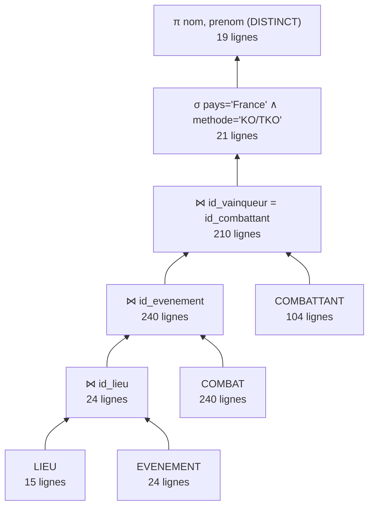
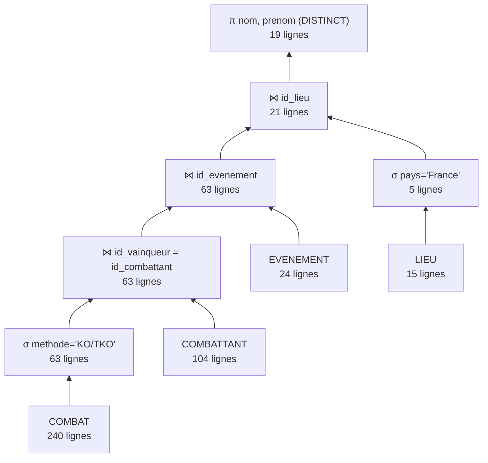
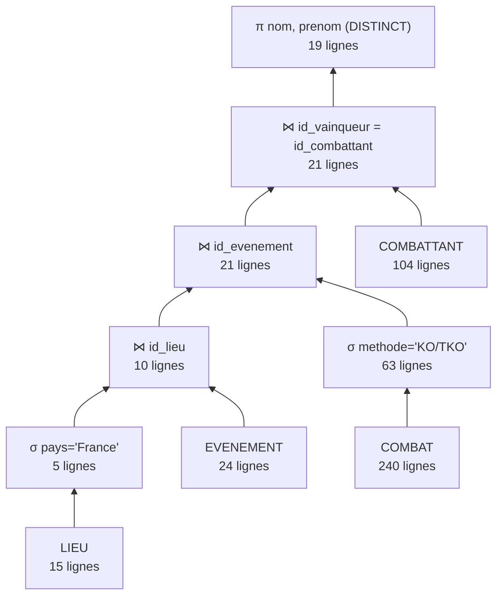

# Mini-projet BDD — Base de données d'une ligue de MMA (partie 2)

TI503N – Bases de données 1 · EFREI

Base de données d'une ligue professionnelle de MMA fictive (« LMMA ») : combattants, contrats, catégories de poids, classements, règnes de champion, événements, lieux, combats, personnel officiel et notes des juges.

## Contenu du dépôt

| Fichier | Rôle |
|---|---|
| `README.md` | Documentation : MLD, choix du MPD, scénario d'utilisation, étude des plans d'exécution |
| `1_creation.sql` | MPD : création de la base, des tables, clés primaires et étrangères (contraintes d'intégrité) |
| `2_contraintes.sql` | Contraintes de validation (règles métier) : `CHECK`, `UNIQUE`, `DEFAULT` |
| `prompt_insertion.txt` | Prompt utilisé avec l'IA générative pour produire les données |
| `3_insertion.sql` | Script d'insertion des données |
| `4_interrogation.sql` | 27 requêtes d'interrogation commentées |

**Exécution** (MySQL 8 ou MariaDB 10.5+), dans cet ordre :

```bash
mysql -u root -p < 1_creation.sql
mysql -u root -p < 2_contraintes.sql
mysql -u root -p < 3_insertion.sql
mysql -u root -p ligue_mma < 4_interrogation.sql
```

---

## III.A — MLD

Obtenu à partir du MCD par application des règles de transformation (notation : <u>clé primaire</u>, `#` clé étrangère).

```
CATEGORIE (id_categorie, nom, limite_poids, sexe)
LIEU (id_lieu, nom, ville, pays, capacite)
TYPE_COMBAT (code_type, titre, nombre_rounds)
PERSONNEL (num_licence, nom, fonction)
MISE_A_JOUR_CLASSEMENT (date_maj)
COMBATTANT (id_combattant, nom, prenom, surnom, date_naissance, nationalite, taille, #id_categorie)
CONTRAT (num_contrat, date_debut, date_fin, combats_garantis, bourse_base, #id_combattant)
REGNE (#id_categorie, date_debut, #id_combattant)
EST_CLASSE (#id_combattant, #id_categorie, #date_maj, position)
EVENEMENT (id_evenement, nom, date_evenement, #id_lieu, #id_combattant_perf)
EST_AFFECTE (#id_evenement, #num_licence)
COMBAT (#id_evenement, num_ordre, methode_victoire, round_fin, temps, #id_categorie,
        #code_type, #num_licence_arbitre, #id_vainqueur, #id_evenement_soiree)
OPPOSE (#id_combattant, #(id_evenement, num_ordre))
NOTE (#id_combattant, #(id_evenement, num_ordre), #num_licence, score)
```

Clés primaires : `CATEGORIE(id_categorie)`, `LIEU(id_lieu)`, `TYPE_COMBAT(code_type)`, `PERSONNEL(num_licence)`, `MISE_A_JOUR_CLASSEMENT(date_maj)`, `COMBATTANT(id_combattant)`, `CONTRAT(num_contrat)`, `REGNE(id_categorie, date_debut)`, `EST_CLASSE(id_combattant, id_categorie, date_maj)`, `EVENEMENT(id_evenement)`, `EST_AFFECTE(id_evenement, num_licence)`, `COMBAT(id_evenement, num_ordre)`, `OPPOSE(id_combattant, id_evenement, num_ordre)`, `NOTE(id_combattant, id_evenement, num_ordre, num_licence)`.

### Règles de transformation appliquées

| Élément du MCD | Règle | Résultat |
|---|---|---|
| Entités | Une entité → une table, l'identifiant devient la clé primaire | `CATEGORIE`, `LIEU`, `COMBATTANT`, … |
| `appartient a` (1,1 – 0,n), `signe`, `acceuille`, `Se deroule en`, `est de type`, `arbitre` | Association binaire 1,1 / 0,n → clé étrangère `NOT NULL` côté 1,1 | `COMBATTANT.id_categorie`, `CONTRAT.id_combattant`, `EVENEMENT.id_lieu`, `COMBAT.id_categorie`, `COMBAT.code_type`, `COMBAT.num_licence_arbitre` |
| `remporte` (0,1 – 0,n) | Clé étrangère facultative (`NULL`) côté 0,1 | `COMBAT.id_vainqueur` (NULL = nul, no contest ou combat à venir) |
| `performance de la soirée`, `combat de la soirée` (0,1 – 0,1) | Clé étrangère facultative d'un seul côté (+ `UNIQUE` pour garder le 0,1) | `EVENEMENT.id_combattant_perf`, `COMBAT.id_evenement_soiree UNIQUE` |
| `comporte` 1,1(R) et `concerne` 1,1(R) | Identification relative : la clé de l'entité forte entre dans la clé primaire de l'entité faible | `COMBAT(#id_evenement, num_ordre)`, `REGNE(#id_categorie, date_debut)` |
| `detient le titre` (1,1 – 0,n) | Clé étrangère `NOT NULL` | `REGNE.id_combattant` |
| `Oppose` (2,2 – 0,n), `est affecte à` (0,n – 1,n) | Association n,n → table dont la clé est la concaténation des clés | `OPPOSE`, `EST_AFFECTE` |
| `est classé` (ternaire, attribut `position`), `note` (ternaire, attribut `score`) | Association ternaire → table avec les trois clés étrangères ; l'attribut de l'association devient colonne | `EST_CLASSE`, `NOTE` |

---

## III.B — MPD

### Contraintes d'intégrité (`1_creation.sql`)

- **Intégrité d'entité** : clé primaire sur chaque table (simple, composée ou incluant une clé étrangère pour les entités faibles).
- **Intégrité de domaine** : types adaptés (`DECIMAL` pour les poids et bourses, `DATE`, `TIME` pour le temps du dernier round, `BOOLEAN` pour « titre O/N »), `NOT NULL` sur les attributs obligatoires.
- **Intégrité référentielle** : 24 clés étrangères, avec gestion automatique (aucune erreur levée) :

| Situation | Action choisie | Justification |
|---|---|---|
| Modification d'une clé référencée | `ON UPDATE CASCADE` partout | la nouvelle valeur est répercutée dans toutes les tables filles |
| Suppression d'un parent dont dépend obligatoirement la ligne fille (1,1, entité faible, table d'association) | `ON DELETE CASCADE` | la ligne fille n'a plus de sens (ex. supprimer un événement supprime ses combats, oppositions et notes) |
| Suppression d'un parent référencé de façon facultative (0,1) | `ON DELETE SET NULL` | la ligne fille est conservée (ex. supprimer un combattant conserve le combat, `id_vainqueur` devient NULL) |

### Contraintes de validation (`2_contraintes.sql`)

Ajoutées avec `ALTER TABLE ... ADD CONSTRAINT`, elles traduisent les règles métier :

| Type (cours) | Exemples |
|---|---|
| `CHECK` avec comparaison | `capacite >= 500`, `bourse_base >= 10000`, `date_evenement >= '2020-01-01'` |
| `CHECK` avec `BETWEEN` | `taille BETWEEN 150 AND 220`, `score BETWEEN 21 AND 50`, `round_fin BETWEEN 1 AND 5`, `temps BETWEEN '00:00:01' AND '00:05:00'` |
| `CHECK` avec `IN` | `sexe IN ('M','F')`, `nombre_rounds IN (3,5)`, méthodes de victoire, fonctions du personnel |
| `CHECK` avec masque `LIKE` (format) | `num_licence LIKE 'LIC-____'`, nom commençant par une majuscule |
| `CHECK` multi-colonnes | `date_fin > date_debut` ; un combat pour le titre se dispute en 5 rounds |
| `CHECK` conditionnel | une décision implique `temps = '05:00'` ; méthode, round et temps sont tous renseignés ou tous NULL |
| `UNIQUE` (simple et composée) | nom de catégorie, surnom, `(nom, prenom, date_naissance)`, `(id_categorie, date_maj, position)`, un seul combat de la soirée par événement |
| `DEFAULT` | `pays = 'France'`, `titre = FALSE`, `nombre_rounds = 3`, `combats_garantis = 4` |

> MySQL 8 interdit un `CHECK` sur une colonne de clé étrangère ayant une action `CASCADE`/`SET NULL` (erreur 3823). Les règles portant sur ces colonnes (le vainqueur est l'un des deux adversaires, par ex.) sont donc listées dans le bilan critique.

### Démonstration (pour la vidéo)

```sql
-- Violation d'une contrainte de validation -> refusée
INSERT INTO NOTE VALUES (1, 1, 1, 'LIC-J009', 60);      -- ck_note_score
INSERT INTO PERSONNEL VALUES ('ABC', 'Test', 'Juge');    -- ck_personnel_licence
-- Violation d'intégrité référentielle -> refusée
INSERT INTO OPPOSE VALUES (999, 1, 1);                   -- combattant 999 inexistant

-- Modification en cascade : la nouvelle licence apparaît dans COMBAT et EST_AFFECTE
UPDATE PERSONNEL SET num_licence = 'LIC-Z999' WHERE num_licence = 'LIC-A001';
SELECT COUNT(*) FROM COMBAT WHERE num_licence_arbitre = 'LIC-Z999';
-- Suppression en cascade : les 10 combats, 20 oppositions et notes de l'événement disparaissent
DELETE FROM EVENEMENT WHERE id_evenement = 1;
-- Suppression avec SET NULL : les combats gagnés par ce combattant restent, id_vainqueur = NULL
DELETE FROM COMBATTANT WHERE id_combattant = 7;
```

---

## IV — Insertion des données

Les données ont été générées par IA générative à partir du prompt de `prompt_insertion.txt`, construit sur le modèle du TP1 : **rôle** (expert BDD + MMA), **contexte** (description de la base + scripts de création et de contraintes), **tâche** (volumes par table), **contraintes de cohérence** (ordre des FK, respect des `CHECK`, vainqueur parmi les adversaires, notes uniquement pour les décisions, etc.) et **format de sortie** (un script SQL commenté, sans texte autour). Les éléments du prompt du TP1 non pertinents ici (exemples d'un autre domaine) ont été retirés ; les règles propres au MMA ont été ajoutées.

| Table | Lignes | Table | Lignes |
|---|---|---|---|
| CATEGORIE | 12 | EVENEMENT | 24 (dont 2 à venir) |
| LIEU | 15 (9 pays) | COMBAT | 240 |
| TYPE_COMBAT | 4 | OPPOSE | 480 |
| PERSONNEL | 33 | NOTE | 558 |
| COMBATTANT | 104 | EST_AFFECTE | 285 |
| CONTRAT | 138 | EST_CLASSE | 1 536 |
| MISE_A_JOUR_CLASSEMENT | 16 | REGNE | 16 |

Toutes les données sont fictives. La cohérence a été vérifiée par requêtes (0 vainqueur hors des deux adversaires, 0 combattant combattant hors de sa catégorie).

---

## V — Interrogation de la BD

### Scénario d'utilisation

**Utilisatrice : Karine Duval, responsable du matchmaking de la LMMA.**
Nous sommes en novembre 2026. Karine doit construire la carte de **LMMA 25 à Paris (février 2027)** et préparer le **bilan sportif annuel** présenté à la direction. Elle interroge la base pour obtenir :

1. **Préparer l'affiche** : les champions actuels (D7), les prétendants du top 5 qui ne sont pas déjà programmés (D3), les combattants qui ont déjà combattu pour un titre (D2), les invaincus (D1), les combattants les plus victorieux (B3, D6).
2. **Plaire au public parisien** : les combattants ayant gagné par KO en France (C7), les surnoms « à la française » (A3), les finishes au 1er round (A5), les performances de la soirée (C6), les jeunes prospects (A4).
3. **Gérer les contrats** : les contrats importants qui expirent dans l'année (A6), la masse salariale par nationalité (B4), les recrues sous contrat qui n'ont jamais combattu (C3).
4. **Organiser l'événement** : la carte du prochain événement LMMA 23 pour éviter les doublons (C1), les lieux et leur utilisation (C4, D4), le personnel disponible jamais affecté (C5), la charge des arbitres (B6), la sévérité des juges (B7).
5. **Bilan sportif** : profondeur des catégories (B1), méthodes de victoire (B2), durée moyenne des combats (B5), historique des règnes (C2), catégories féminines (A1), nationalités représentées (A2), salles géantes (D4) et comparaisons de gabarit (D5).

### Couverture des types de requêtes (`4_interrogation.sql`)

| Type demandé | Requêtes | Notions |
|---|---|---|
| Projections / sélections (≥ 5) | A1 à A6 | `ORDER BY`, `DISTINCT`, `LIKE`, `IN`, `BETWEEN`, conditions multiples |
| Agrégation (≥ 5) | B1 à B7 | `COUNT`, `AVG`, `MIN`, `MAX`, `GROUP BY`, `HAVING`, sous-requête pour un pourcentage |
| Jointures (≥ 5) | C1 à C7 | jointures internes multiples, auto-jointure (C1), `LEFT JOIN` (C3, C4, C6), `RIGHT JOIN` (C5) |
| Requêtes imbriquées (≥ 5) | D1 à D7 | `IN`, `NOT IN`, `EXISTS`, `NOT EXISTS`, `> ALL`, `> ANY`, sous-requête corrélée, sous-requête dans `FROM` et `HAVING` |

---

## V.3 — Étude des plans d'exécution (requête C7)

**Question** : quels combattants ont gagné par KO/TKO lors d'un événement organisé en France ?

```sql
SELECT DISTINCT c.nom, c.prenom
FROM LIEU l
JOIN EVENEMENT e  ON e.id_lieu = l.id_lieu
JOIN COMBAT cb    ON cb.id_evenement = e.id_evenement
JOIN COMBATTANT c ON c.id_combattant = cb.id_vainqueur
WHERE l.pays = 'France' AND cb.methode_victoire = 'KO/TKO';
```

**Algèbre relationnelle** (3 opérateurs différents : sélection σ, jointure ⋈, projection π) :

π<sub>nom, prenom</sub> ( σ<sub>pays='France'</sub>(LIEU) ⋈<sub>id_lieu</sub> EVENEMENT ⋈<sub>id_evenement</sub> σ<sub>methode='KO/TKO'</sub>(COMBAT) ⋈<sub>id_vainqueur=id_combattant</sub> COMBATTANT )

**Cardinalités** (mesurées sur la base) : LIEU = 15, EVENEMENT = 24, COMBAT = 240, COMBATTANT = 104 ; 5 lieux en France, 10 événements en France, 63 combats gagnés par KO/TKO, 210 combats avec vainqueur.

**Modèle de coût** (comme dans l'exercice 6 du TD3) :
- sélection σ sur une relation de *n* lignes : *n* instructions (une comparaison par ligne) ;
- jointure ⋈ par boucles imbriquées entre *n* et *m* lignes : *n × m* instructions ;
- projection π sur *n* lignes : *n* instructions.

### Plan 1 — plan naïf (jointures d'abord, sélections à la fin)



| Étape | Calcul | Instructions | Lignes obtenues |
|---|---|---|---|
| LIEU ⋈ EVENEMENT | 15 × 24 | 360 | 24 |
| ⋈ COMBAT | 24 × 240 | 5 760 | 240 |
| ⋈ COMBATTANT | 240 × 104 | 24 960 | 210 |
| σ pays ∧ methode | 210 | 210 | 21 |
| π nom, prenom | 21 | 21 | 19 |
| **Total** | | **31 311** | |

### Plan 2 — sélections descendues, mauvais ordre de jointure



| Étape | Calcul | Instructions | Lignes obtenues |
|---|---|---|---|
| σ methode (COMBAT) | 240 | 240 | 63 |
| ⋈ COMBATTANT | 63 × 104 | 6 552 | 63 |
| ⋈ EVENEMENT | 63 × 24 | 1 512 | 63 |
| σ pays (LIEU) | 15 | 15 | 5 |
| ⋈ σ(LIEU) | 63 × 5 | 315 | 21 |
| π nom, prenom | 21 | 21 | 19 |
| **Total** | | **8 655** | |

### Plan 3 — plan optimisé (sélections au plus tôt, jointures des plus petites relations d'abord)



| Étape | Calcul | Instructions | Lignes obtenues |
|---|---|---|---|
| σ pays (LIEU) | 15 | 15 | 5 |
| σ methode (COMBAT) | 240 | 240 | 63 |
| σ(LIEU) ⋈ EVENEMENT | 5 × 24 | 120 | 10 |
| ⋈ σ(COMBAT) | 10 × 63 | 630 | 21 |
| ⋈ COMBATTANT | 21 × 104 | 2 184 | 21 |
| π nom, prenom | 21 | 21 | 19 |
| **Total** | | **3 210** | |

### Conclusion

| Plan | Instructions | Gain par rapport au plan 1 |
|---|---|---|
| 1 – naïf | 31 311 | — |
| 2 – sélections descendues | 8 655 | ÷ 3,6 |
| 3 – optimisé | **3 210** | **÷ 9,8** |

Le **plan 3** est le plus efficace. Deux règles de l'algèbre l'expliquent :

1. **Descendre les sélections** au plus près des tables (commutativité de σ et ⋈) : on ne joint plus que 5 lieux au lieu de 15 et 63 combats au lieu de 240. C'est le gain principal du plan 1 au plan 2 (la jointure coûteuse COMBAT ⋈ COMBATTANT passe de 240 à 63 lignes).
2. **Ordonner les jointures** pour que les résultats intermédiaires soient les plus petits possible (associativité et commutativité de ⋈) : en partant de la sélection la plus sélective (5 lieux → 10 événements), le résultat intermédiaire tombe à 21 lignes *avant* la jointure avec COMBATTANT, la plus grosse relation. Le plan 2 fait au contraire cette jointure en premier, sur 63 lignes.

On peut aussi descendre les projections (ne garder que `id_vainqueur` et `id_evenement` de COMBAT, `nom` et `prenom` de COMBATTANT) : cela ne change pas le nombre d'instructions dans ce modèle de coût, mais réduit la taille des lignes intermédiaires en mémoire. Les SGBD comme MySQL appliquent automatiquement ces règles (visible avec `EXPLAIN`) et utilisent en plus les index des clés primaires et étrangères, ce qui remplace les boucles imbriquées par des accès indexés.

---

## Pourquoi le modèle est en 3FN

- **1FN** : tous les attributs sont atomiques (pas de liste d'adversaires dans COMBAT : la relation `OPPOSE` porte les deux participants ; pas de liste de juges : table `NOTE`).
- **2FN** : dans les tables à clé composée, aucun attribut ne dépend d'une partie seulement de la clé. Ex. dans `NOTE (id_combattant, id_evenement, num_ordre, num_licence, score)`, le score dépend de la clé entière ; la fonction du juge est stockée dans `PERSONNEL`, pas dans `NOTE`. Dans `COMBAT`, la date et le lieu dépendent de `id_evenement` seul : ils sont donc dans `EVENEMENT`, pas dans `COMBAT`.
- **3FN** : aucun attribut non-clé ne dépend d'un autre attribut non-clé. Ex. le nombre de rounds et le statut « titre » dépendent du type de combat, d'où la table `TYPE_COMBAT` ; la ville, le pays et la capacité dépendent du lieu, d'où la table `LIEU` séparée d'`EVENEMENT`.

---

## Bilan critique et améliorations possibles

- **Règles non garanties par des contraintes déclaratives** : le vainqueur doit être l'un des deux adversaires, chaque combat doit avoir exactement 2 lignes dans `OPPOSE`, les deux adversaires doivent appartenir à la catégorie du combat, l'arbitre doit avoir la fonction « Arbitre », le combat de la soirée doit appartenir au même événement. Ces règles sont respectées par les données mais seraient mieux garanties par des **triggers**.
- **Changement de catégorie** : `COMBATTANT.id_categorie` ne garde que la catégorie actuelle ; un combattant qui change de poids perd cet historique (une table d'historique serait plus juste).
- **`ON DELETE CASCADE` sur les tables de référence** (CATEGORIE, LIEU, TYPE_COMBAT) : imposé par la consigne « sans erreur », mais supprimer une catégorie efface tous ses combattants. En production, on préférerait `RESTRICT` ou une suppression logique (colonne `actif`).
- **Données dérivées** : le palmarès (victoires/défaites) est recalculé à chaque requête ; une vue (`CREATE VIEW palmares`) simplifierait les requêtes.
- **Index** : ajouter des index sur `LIEU.pays` et `COMBAT.methode_victoire` accélérerait les sélections de la requête étudiée.
